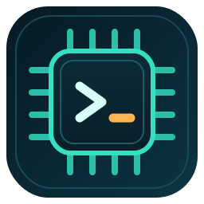

# EIDE Pro



> Unofficial fork of [github0null/eide](https://github.com/github0null/eide),
> maintained at [wuwuzhazha/eide-pro](https://github.com/wuwuzhazha/eide-pro). Adds
> headless CLI/MCP build, flash, and debug with full VS Code build parity.

[](https://github.com/wuwuzhazha/eide-pro)
[](https://github.com/wuwuzhazha/eide-pro/releases)
[](https://open-vsx.org/extension/wuwuzhazha/eide-pro)

***

## Why this fork is not upstreamed

All changes in this fork were produced with AI assistance. Although they are
covered by the test suite, they touch core project-loading and build paths, and
submitting them upstream would put a large review and stability burden on the
upstream maintainers. EIDE Pro is therefore maintained as an independent
reference implementation and installable extension. Upstream remains
[github0null/eide](https://github.com/github0null/eide).

## [中文](./README_ZH-CN.md)

## Summary 📑

A mcu development environment for `8051/STM8/Cortex-M/MIPS/RISC-V` on VsCode. 

Provide `8051/STM8/Cortex-M/MIPS/RISC-V` project development, compilation, program flash and other functions.

Supported Platforms: 
  - **Windows x64 (>= Windows 10)**
  - **Linux x64**
  - **macOS**(Only tested in 'macOS 10.15 x64')


***

## Install

From Open VSX:

```bash
code --install-extension wuwuzhazha.eide-pro
```

Or install the latest VSIX from
[GitHub Releases](https://github.com/wuwuzhazha/eide-pro/releases).

***

## Features 🎉

* Support 8051, STM8, Cortex-M, MIPS MTI, RISC-V, GCC projects.
* Support to import KEIL5/IAR/Eclipse projects, support to import 'IAR-STM8, IAR-ARM, Segger Embedded Studio' project source file resource tree.
* Support for installing standard KEIL chip support packs (only for Cortex-M projects).
* Provides many project templates for quick start a project.
* Build, rebuild, support many toolchains (armcc, gcc-arm-none-eabi, llvm-for-arm, riscv-gcc, xxx-gcc, keil_c51, sdcc ...).
* Program flash, support: jlink, stlink, openocd, pyocd ...
* ~~Built-in serial port monitor~~ (recommended to use `Serial Monitor` plug-in).
* Supports static checking projects by using Cppcheck.
* Automatically generates default debug configurations for debugger plug-in `cortex-debug, STM8-Debug`.
* Built-in many utility tools, 'CMSIS Config Wizard UI', 'Disassembly view', 'Program resource view'...
* Built-in implement `C/C++ IntelliSense Provider` for `ms-vscode.cpptools`, **Not Need to** configurate `c_cpp_properties.json` file.
* Built-in Msys Unix Shell environment.
* Built-in Callgraph gui tool for gcc toolchain.
* Support MCP Tools for VS Code and headless CLI/MCP workflows. See the [EIDE MCP skill](./docs/skills/README.md) for installation and usage.

***

## Quick Start 🏃‍♀️

1. Install any of the above compilers

2. Open the **Operations** bar of the extension to set the compiler installation path

3. Click on the `New` or `Import` function in the Operations bar to start your project

***

## Getting Start 📖

[https://em-ide.com](https://em-ide.com)

***

## Example

- Create A Project By Internal Template


- Build Project


- Flash Project (It failed because there was no connection to the development board, for demonstration purposes only)


- Show Source File Disassembly Code


- Program Resource View


***

## ChangeLog 📌

[ChangeLog](./CHANGELOG.md)

***

## Community 🌈

- [Github](https://github.com/wuwuzhazha/eide-pro/issues)

- [Forum https://discuss.em-ide.com](https://discuss.em-ide.com/)

***

## How to build ?

You can build this project by your self.

> [!IMPORTANT]  
> The required version of NodeJS is **18** because of some historical reasons for this extension.

1. Install `NodeJS 18` (recommanded v18.18.2). You can use `nvm` to manage your NodeJS.
   Install `vsce` by `npm install -g cheerio@1.0.0-rc.9 @vscode/vsce@2.15.0`

2. Clone this repo, Open folder by vscode and then run command: 

   ```shell
   npm install
   ```

3. Press `ctrl+shift+b` to show vscode task

   - Use `npm: webpack` to build this extension, and then you can press F5 to debug it.

   - Use `build vsix` to build as a vsix package.


> [!NOTE]  
> There may be syntax errors when opening project source code using VSCode, this is because the project uses an older Version of TypeScript, please press `Ctrl+Shift+P` to execute `TypeScript: Select TypeScript Version...` and select version: `v5.8.2`.

## Contribution Guidelines

If you have any good ideas, you can first put forward your suggestions in the issue section. If they are feasible, we will implement them later. If you want to add features by yourself, please also share your ideas at the very beginning (otherwise, we cannot guarantee that your PR will be merged). 
If you are ready and have completed the debugging and testing, then you can submit a pull request request to the dev branch. Thanks.

## License

MIT. See [LICENSE](./LICENSE) and [THIRD_PARTY_NOTICES.md](./THIRD_PARTY_NOTICES.md).

## Sponsor 👍

[Sponsor The Author](https://em-ide.com/sponsor)

Thanks:

